# 基于springboot的旅游出行指南655ms--论文

> 🎓 **计算机毕业设计 · 基于springboot的旅游出行指南655ms--论文**
>
> 本仓库只放**项目介绍 + 运行截图**（截图是站点带水印的原图，存在仓库 `images/` 里）。
>
> 👉 **完整可运行源码 / 数据库脚本 / 部署文档：[点我获取](https://geekcode.top/archives/%E5%9F%BA%E4%BA%8Espringboot%E7%9A%84%E6%97%85%E6%B8%B8%E5%87%BA%E8%A1%8C%E6%8C%87%E5%8D%97655ms-%E8%AE%BA%E6%96%87?utm_source=github)**
>
> 💬 咨询微信：**ir9372**　|　🌐 更多项目：[极客代码 geekcode.top](https://geekcode.top/?utm_source=github)
>
> 📌 项目详情页：<https://geekcode.top/archives/%E5%9F%BA%E4%BA%8Espringboot%E7%9A%84%E6%97%85%E6%B8%B8%E5%87%BA%E8%A1%8C%E6%8C%87%E5%8D%97655ms-%E8%AE%BA%E6%96%87?utm_source=github>

<table><td width="230" align="center"> <b>扫码加微信 ir9372</b></td><td valign="middle">📦 源码 = 项目介绍 + 全部运行截图 + 数据库 + 部署文档 👉 点上方任意截图，直接跳到 <b>极客代码 geekcode.top</b> 详情页</td></table>

---

<h1>基于springboot的旅游出行指南_655ms--论文</h1>
<h2>项目概述</h2>

本项目旨在构建一个集信息展示、在线预订与互动社区于一体的旅游出行指南平台，解决游客在规划行程时面临的信息分散、预订流程繁琐及缺乏实时参考等痛点。系统核心功能涵盖景点、酒店、餐厅信息的浏览与评论，支持门票、酒店及餐厅的在线预订，并提供交通路线查询、天气预报查看及旅行日记分享服务。后台管理端实现对上述所有业务数据的全生命周期管理及用户权限控制。项目采用前后端分离架构，基于 Spring Boot 后端框架与 Vue 前端技术栈开发，适用于个人游客进行自助游规划，以及旅游管理部门或运营商进行内容运营与服务管理。

<h2>技术架构</h2>
<h3>1. 总体架构设计</h3>

项目采用经典的前后端分离模式（Vue-integrated），通过 RESTful API 进行数据交互。

<ul>
<li><strong>前端层</strong>：基于 Vue.js 框架构建单页面应用（SPA），负责视图渲染、用户交互及路由跳转，分为前台用户界面和后台管理界面。</li>
<li><strong>后端层</strong>：基于 Spring Boot 框架搭建微服务基础架构，提供高可用的接口服务。利用 Shiro 实现安全认证与授权，MyBatis-Plus 作为持久层框架简化数据库操作。</li>
<li><strong>数据层</strong>：使用 MySQL 关系型数据库存储业务数据，Redis（若配置中隐含缓存策略则提及，否则仅提MySQL）用于提升热点数据读取性能。</li>
</ul>
<h3>2. 核心技术选型理由</h3>
<ul>
<li><strong>Spring Boot</strong>: 提供“约定优于配置”的开发体验，快速集成 Web、JDBC 及各类 Starter，降低项目搭建复杂度，确保系统的稳定性与可扩展性。</li>
<li><strong>MyBatis-Plus</strong>: 在 MyBatis 基础上增强，提供了通用的 CRUD 方法、条件构造器及分页插件，显著减少重复代码编写，提高开发效率。</li>
<li><strong>Apache Shiro</strong>: 轻量级且强大的 Java 安全框架，灵活处理身份验证、授权、会话管理和加密，适合本项目的多角色权限控制需求。</li>
<li><strong>Vue.js</strong>: 响应式数据绑定组件化开发模式，使得前后端逻辑清晰分离，便于维护复杂的用户界面和后台管理系统。</li>
</ul>
<h3>3. 数据库设计要点</h3>

数据库设计遵循第三范式，主要实体包括用户、景点、酒店、餐厅、交通路线、旅行日记、公告、订单（门票/酒店/餐厅预订）、评论及系统配置。各实体间通过外键建立关联，如评论表关联对应的景点、酒店或餐厅ID，订单表关联用户ID及商品ID，确保数据的一致性与完整性。

<h2>功能模块</h2>
<h3>1. 前台用户端</h3>

前台面向普通游客，提供旅游资讯浏览、服务预订及社交互动功能。

<table>
<thead>
<tr>
<th align="left">模块名称</th>
<th align="left">功能描述</th>
</tr>
</thead>
<tbody><tr>
<td align="left"><strong>首页</strong></td>
<td align="left">展示轮播图、热门景点推荐、最新公告及天气概况，作为流量入口引导用户深入探索。</td>
</tr>
<tr>
<td align="left"><strong>景点信息</strong></td>
<td align="left">列表展示旅游景点详情，支持按类别筛选；进入详情页可查看图片、介绍及用户评论；支持收藏功能。</td>
</tr>
<tr>
<td align="left"><strong>酒店信息</strong></td>
<td align="left">展示酒店列表及详细信息，包含价格、设施、位置等；支持酒店预订下单；提供酒店评论查看与发布。</td>
</tr>
<tr>
<td align="left"><strong>餐厅信息</strong></td>
<td align="left">展示特色餐厅列表及菜单详情；支持餐厅预订；提供餐厅评论互动。</td>
</tr>
<tr>
<td align="left"><strong>交通路线</strong></td>
<td align="left">提供不同目的地间的交通方案查询，展示路线详情及耗时；支持对交通路线进行评论反馈。</td>
</tr>
<tr>
<td align="left"><strong>旅行日记</strong></td>
<td align="left">用户可浏览他人分享的旅行游记，支持点赞、收藏及发表评论；具备日记发布与管理功能（依据个人中心存在推断）。</td>
</tr>
<tr>
<td align="left"><strong>门票预订</strong></td>
<td align="left">针对景点门票的在线购买流程，生成电子订单并支持状态查询。</td>
</tr>
<tr>
<td align="left"><strong>天气预报</strong></td>
<td align="left">展示目的地的实时天气及未来预报，辅助用户出行决策。</td>
</tr>
<tr>
<td align="left"><strong>公告信息</strong></td>
<td align="left">发布平台通知、活动信息及重要提醒。</td>
</tr>
<tr>
<td align="left"><strong>个人中心</strong></td>
<td align="left">用户信息管理、我的订单（门票/酒店/餐厅）、我的收藏、我的评论记录等功能。</td>
</tr>
</tbody></table>
<h3>2. 后台管理端</h3>

后台面向管理员，提供全量数据的增删改查及系统配置管理。

<table>
<thead>
<tr>
<th align="left">模块名称</th>
<th align="left">功能描述</th>
</tr>
</thead>
<tbody><tr>
<td align="left"><strong>系统登录</strong></td>
<td align="left">管理员身份认证入口，基于 Shiro 进行安全校验。</td>
</tr>
<tr>
<td align="left"><strong>首页仪表盘</strong></td>
<td align="left">展示关键业务数据统计概览，如今日订单数、新增用户数等。</td>
</tr>
<tr>
<td align="left"><strong>景点信息管理</strong></td>
<td align="left">景点数据的录入、编辑、删除及上下架管理；审核景点相关评论。</td>
</tr>
<tr>
<td align="left"><strong>酒店信息管理</strong></td>
<td align="left">酒店数据的维护，包括房型、价格、库存管理；审核酒店评论。</td>
</tr>
<tr>
<td align="left"><strong>餐厅信息管理</strong></td>
<td align="left">餐厅数据的维护，包括菜品、营业时间管理；审核餐厅评论。</td>
</tr>
<tr>
<td align="left"><strong>交通路线管理</strong></td>
<td align="left">交通路线数据的配置与维护；审核路线评论。</td>
</tr>
<tr>
<td align="left"><strong>预订管理</strong></td>
<td align="left">- <strong>门票预订管理</strong>: 查看所有门票订单，处理退款或核销。- <strong>酒店预订管理</strong>: 查看所有酒店订单，确认入住状态。- <strong>餐厅预订管理</strong>: 查看所有餐厅订座订单，处理预约状态。</td>
</tr>
<tr>
<td align="left"><strong>内容管理</strong></td>
<td align="left">- <strong>旅行日记管理</strong>: 审核用户发布的日记，管理违规内容。- <strong>公告信息管理</strong>: 发布、编辑、删除平台公告。- <strong>轮播图管理</strong>: 配置首页展示的轮播图片及跳转链接。</td>
</tr>
<tr>
<td align="left"><strong>用户管理</strong></td>
<td align="left">注册用户列表查看，禁用异常账号，重置密码等操作。</td>
</tr>
<tr>
<td align="left"><strong>系统配置</strong></td>
<td align="left">网站基本参数设置，如站点名称、Logo、联系方式等。</td>
</tr>
</tbody></table>
<h2>用户角色与权限</h2>

系统主要划分为两个角色：<strong>普通用户</strong>和<strong>管理员</strong>。

<h3>1. 普通用户 (User)</h3>
<ul>
<li><strong>访问权限</strong>：仅限前台界面。</li>
<li><strong>功能权限</strong>：<ul>
<li><strong>浏览与搜索</strong>：查看所有公开的旅游资讯（景点、酒店、餐厅、交通、天气、公告、日记）。</li>
<li><strong>互动操作</strong>：注册/登录账户，对景点、酒店、餐厅、交通路线、旅行日记发表文字评论；收藏感兴趣的内容。</li>
<li><strong>交易操作</strong>：提交门票、酒店、餐厅的预订申请，查看自己的历史订单状态。</li>
<li><strong>个人信息管理</strong>：修改个人资料，查看我的收藏夹和我的评论记录。</li>
</ul>
</li>
</ul>
<h3>2. 管理员 (Admin)</h3>
<ul>
<li><strong>访问权限</strong>：仅限后台管理界面。</li>
<li><strong>功能权限</strong>：<ul>
<li><strong>数据维护</strong>：对景点、酒店、餐厅、交通路线、公告、轮播图等基础数据进行完整的 CRUD（增删改查）操作。</li>
<li><strong>订单处理</strong>：监控和管理所有类型的预订订单（门票、酒店、餐厅），执行审核、取消或完成操作。</li>
<li><strong>内容审核</strong>：管理用户生成的内容，包括审核旅行日记、回复或删除不当评论。</li>
<li><strong>用户管理</strong>：查看用户列表，管理用户状态（启用/禁用）。</li>
<li><strong>系统配置</strong>：修改全局系统参数。</li>
</ul>
</li>
</ul>

<em>注：根据现有源码结构，未明确细分超级管理员与普通操作员权限，默认所有后台登录者拥有上述全部管理权限。</em>

<h2>项目特色与创新点</h2>
<ol>
<li><strong>一站式旅游服务闭环</strong>：不同于单一的信息展示平台，本项目整合了“看（资讯/日记）”、“选（景点/酒店/餐厅对比）”、“行（交通/天气）”、“住/食/玩（预订）”全流程，为用户提供从规划到执行的完整解决方案。</li>
<li><strong>多维度的互动评价体系</strong>：不仅限于景点评论，还创新性地引入了对“交通路线”和“旅行日记”的评论机制。这种细粒度的反馈有助于其他用户获取更真实的出行经验，特别是交通方式的优劣评价，极具实用价值。</li>
<li><strong>实时环境感知集成</strong>：将“天气预报”模块直接嵌入前台导航，使旅游规划不再脱离实际气象条件，提升了出行的安全性和舒适度，体现了以用户为中心的设计思路。</li>
<li><strong>标准化的前后端分离架构</strong>：采用 Spring Boot + Vue 的主流技术栈，结合 Shiro 安全框架和 MyBatis-Plus 高效持久层，保证了系统的高内聚低耦合，具备良好的可维护性和扩展性，适合作为毕业设计的工程实践范例。</li>
</ol>
<h2>部署环境</h2>

为确保项目正常运行，需准备以下软件环境：

<table>
<thead>
<tr>
<th align="left">组件</th>
<th align="left">版本要求</th>
<th align="left">说明</th>
</tr>
</thead>
<tbody><tr>
<td align="left"><strong>JDK</strong></td>
<td align="left">1.8+</td>
<td align="left">Java 运行环境，建议 JDK 1.8 或 11，兼容 Spring Boot 版本。</td>
</tr>
<tr>
<td align="left"><strong>Maven</strong></td>
<td align="left">3.6+</td>
<td align="left">项目依赖管理与构建工具。</td>
</tr>
<tr>
<td align="left"><strong>MySQL</strong></td>
<td align="left">5.7+ / 8.0+</td>
<td align="left">关系型数据库，需导入项目提供的 SQL 初始化脚本。</td>
</tr>
<tr>
<td align="left"><strong>Node.js</strong></td>
<td align="left">14+</td>
<td align="left">前端 Vue 项目构建环境，配合 npm/yarn 使用。</td>
</tr>
<tr>
<td align="left"><strong>IntelliJ IDEA</strong></td>
<td align="left">最新版</td>
<td align="left">后端开发与调试 IDE。</td>
</tr>
<tr>
<td align="left"><strong>VS Code</strong></td>
<td align="left">最新版</td>
<td align="left">前端开发与调试 IDE。</td>
</tr>
<tr>
<td align="left"><strong>浏览器</strong></td>
<td align="left">Chrome/Edge</td>
<td align="left">推荐现代内核浏览器以获得最佳兼容性。</td>
</tr>
</tbody></table>

<strong>部署步骤简述</strong>：

<ol>
<li>安装并启动 MySQL，创建数据库并执行 SQL 文件。</li>
<li>修改后端 <code>application.yml</code> 中的数据库连接信息（URL, Username, Password）。</li>
<li>使用 Maven 打包后端项目 (<code>mvn clean package</code>)，运行生成的 jar 包 (<code>java -jar xxx.jar</code>)。</li>
<li>进入前端项目目录，安装依赖 (<code>npm install</code>)，启动开发服务器 (<code>npm run serve</code>) 或打包生产环境 (<code>npm run build</code>)。</li>
<li>访问本地端口即可使用系统。</li>
</ol>
<h2>五、技术特性</h2>
<ul>
<li>前后端集成部署，前端资源打包至后端 static 目录</li>
<li>使用 MyBatis-Plus 简化数据访问层开发</li>
<li>集成 Shiro 权限框架实现角色权限控制</li>
</ul>
<h2>六、功能模块截图</h2>
<h3>前台用户端</h3>
<h4>前台-餐厅信息列表</h4>

<a href="https://geekcode.top/archives/%E5%9F%BA%E4%BA%8Espringboot%E7%9A%84%E6%97%85%E6%B8%B8%E5%87%BA%E8%A1%8C%E6%8C%87%E5%8D%97655ms-%E8%AE%BA%E6%96%87?utm_source=github" title="查看完整源码">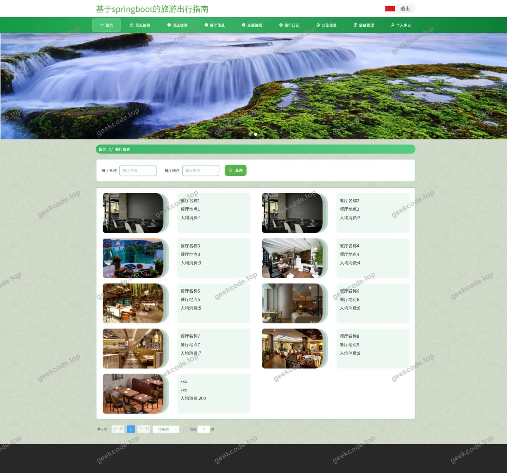</a>

<h4>前台-餐厅预订列表</h4>

<a href="https://geekcode.top/archives/%E5%9F%BA%E4%BA%8Espringboot%E7%9A%84%E6%97%85%E6%B8%B8%E5%87%BA%E8%A1%8C%E6%8C%87%E5%8D%97655ms-%E8%AE%BA%E6%96%87?utm_source=github" title="查看完整源码">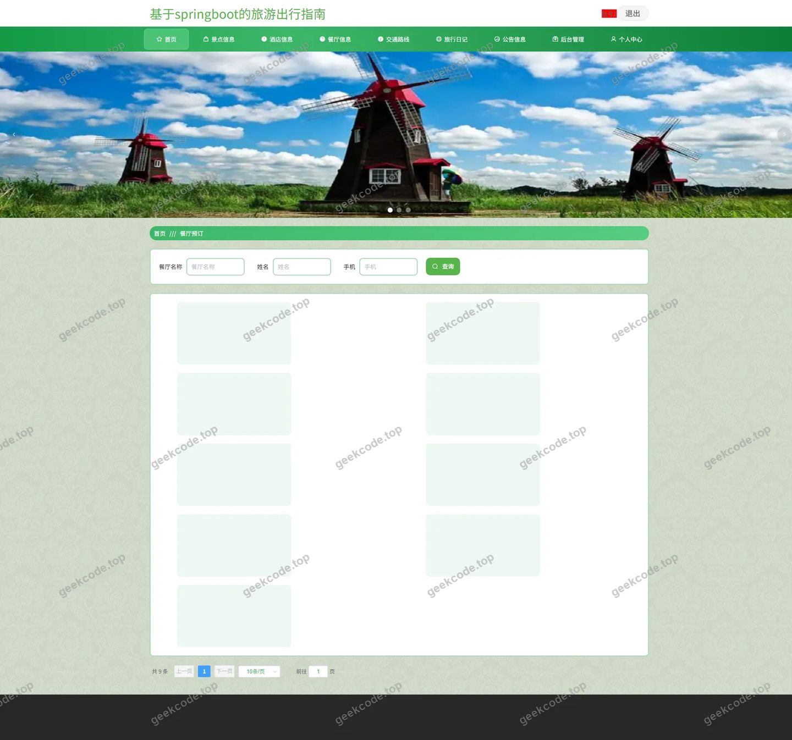</a>

<h4>前台-交通路线列表</h4>

<a href="https://geekcode.top/archives/%E5%9F%BA%E4%BA%8Espringboot%E7%9A%84%E6%97%85%E6%B8%B8%E5%87%BA%E8%A1%8C%E6%8C%87%E5%8D%97655ms-%E8%AE%BA%E6%96%87?utm_source=github" title="查看完整源码">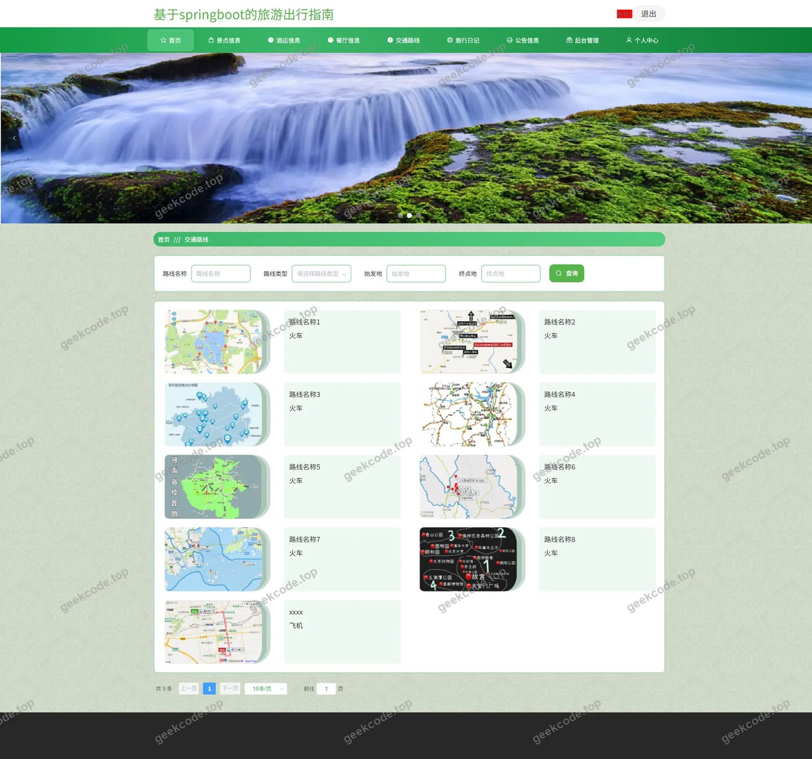</a>

<h4>前台-景点信息列表</h4>

<a href="https://geekcode.top/archives/%E5%9F%BA%E4%BA%8Espringboot%E7%9A%84%E6%97%85%E6%B8%B8%E5%87%BA%E8%A1%8C%E6%8C%87%E5%8D%97655ms-%E8%AE%BA%E6%96%87?utm_source=github" title="查看完整源码">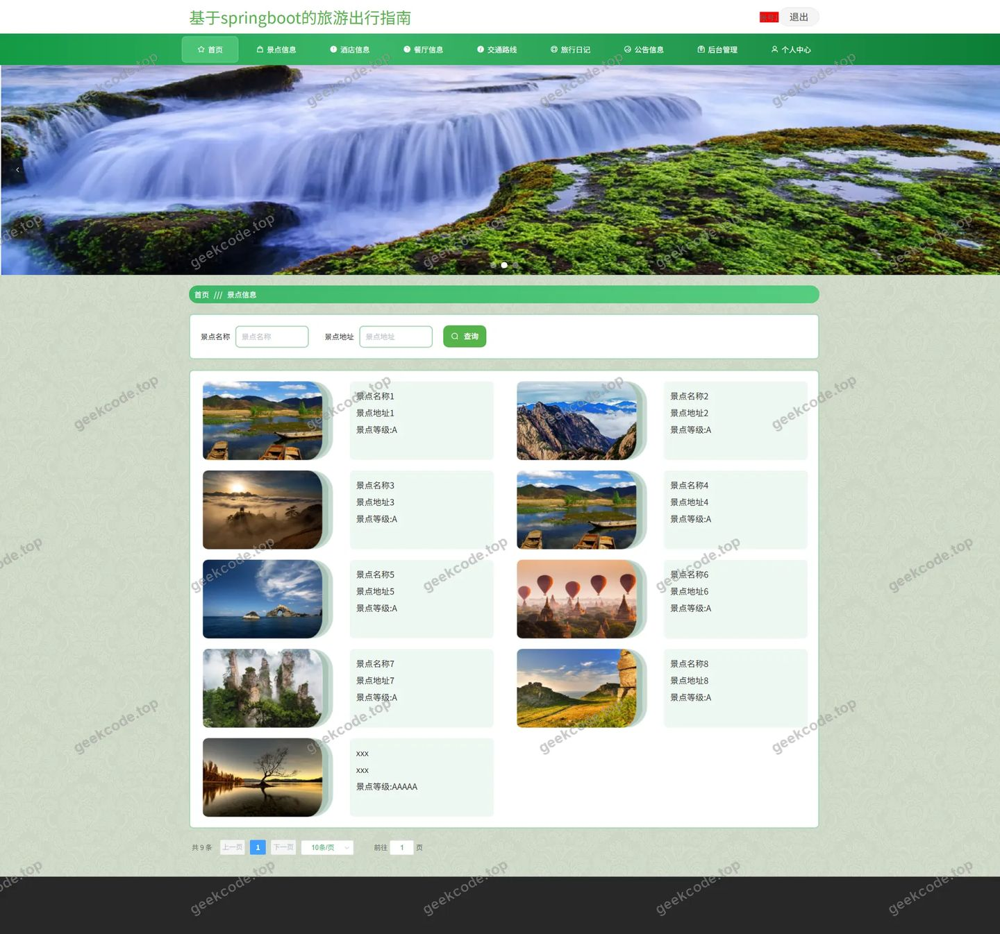</a>

<h4>前台-酒店信息列表</h4>

<a href="https://geekcode.top/archives/%E5%9F%BA%E4%BA%8Espringboot%E7%9A%84%E6%97%85%E6%B8%B8%E5%87%BA%E8%A1%8C%E6%8C%87%E5%8D%97655ms-%E8%AE%BA%E6%96%87?utm_source=github" title="查看完整源码">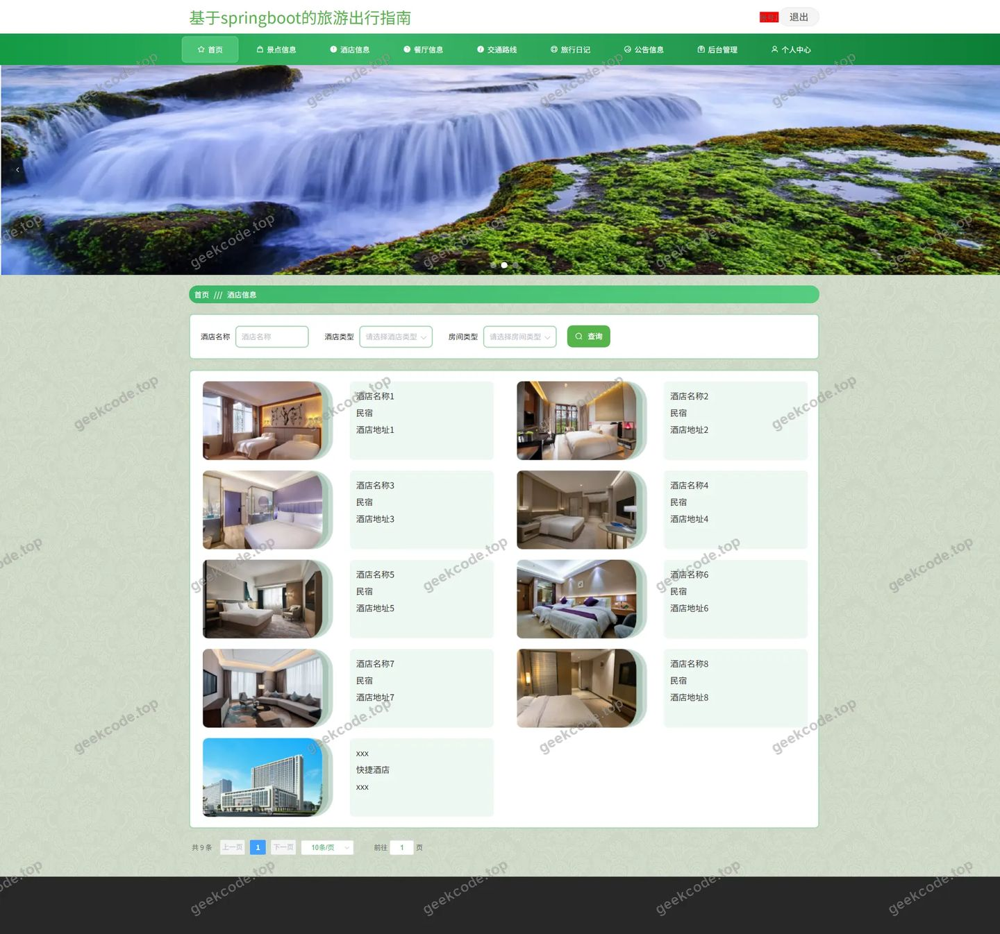</a>

<h4>前台-酒店预订列表</h4>

<a href="https://geekcode.top/archives/%E5%9F%BA%E4%BA%8Espringboot%E7%9A%84%E6%97%85%E6%B8%B8%E5%87%BA%E8%A1%8C%E6%8C%87%E5%8D%97655ms-%E8%AE%BA%E6%96%87?utm_source=github" title="查看完整源码">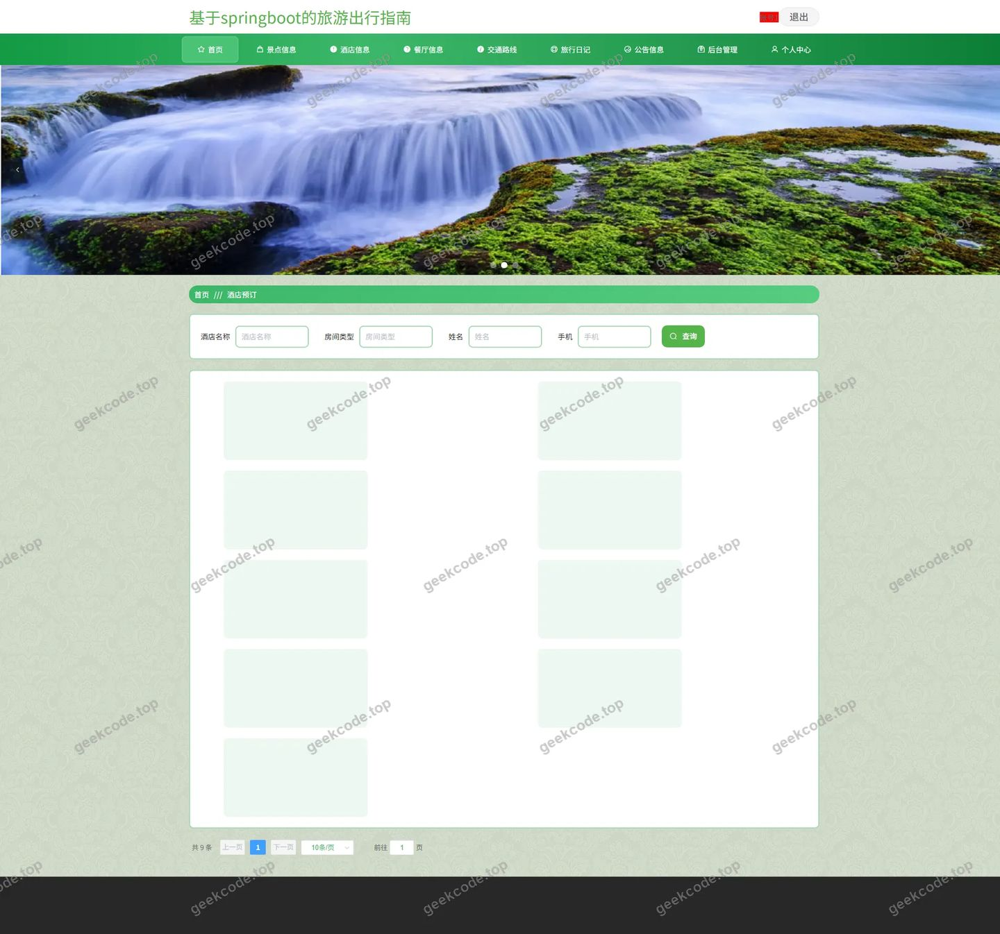</a>

<h4>前台-旅行日记列表</h4>

<a href="https://geekcode.top/archives/%E5%9F%BA%E4%BA%8Espringboot%E7%9A%84%E6%97%85%E6%B8%B8%E5%87%BA%E8%A1%8C%E6%8C%87%E5%8D%97655ms-%E8%AE%BA%E6%96%87?utm_source=github" title="查看完整源码">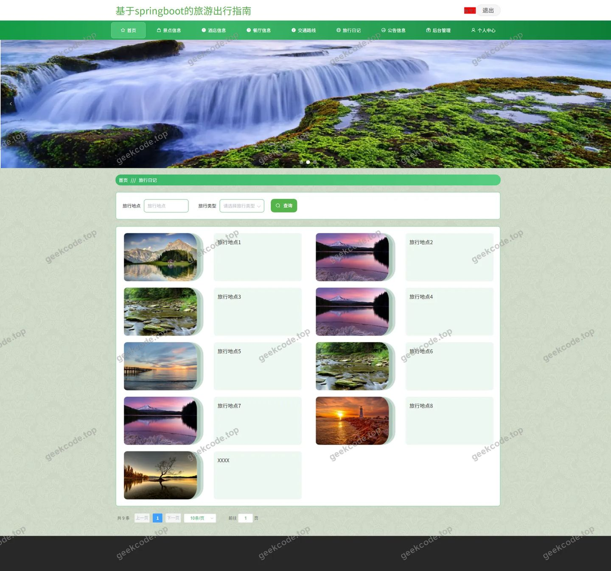</a>

<h4>前台-旅游规划列表</h4>

<h4>前台-门票预订列表</h4>

<a href="https://geekcode.top/archives/%E5%9F%BA%E4%BA%8Espringboot%E7%9A%84%E6%97%85%E6%B8%B8%E5%87%BA%E8%A1%8C%E6%8C%87%E5%8D%97655ms-%E8%AE%BA%E6%96%87?utm_source=github" title="查看完整源码">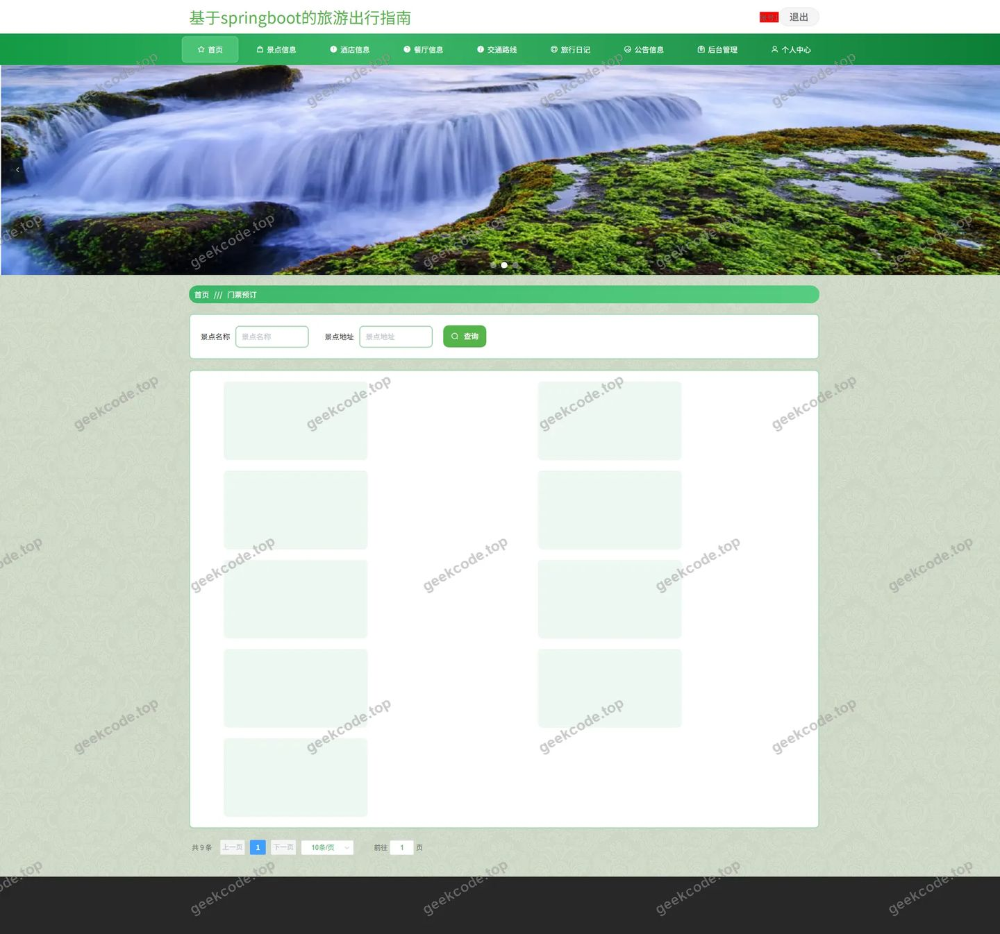</a>

<h4>前台-收藏列表</h4>

<a href="https://geekcode.top/archives/%E5%9F%BA%E4%BA%8Espringboot%E7%9A%84%E6%97%85%E6%B8%B8%E5%87%BA%E8%A1%8C%E6%8C%87%E5%8D%97655ms-%E8%AE%BA%E6%96%87?utm_source=github" title="查看完整源码">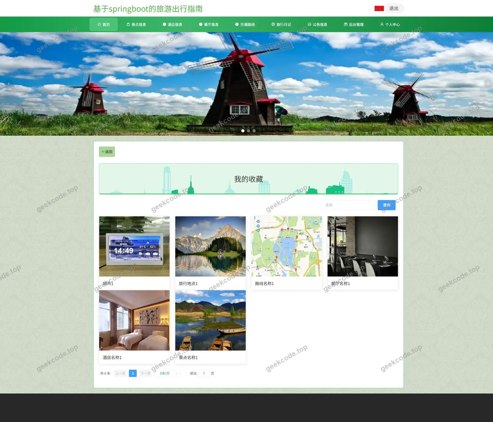</a>

<h4>前台-天气预报列表</h4>

<a href="https://geekcode.top/archives/%E5%9F%BA%E4%BA%8Espringboot%E7%9A%84%E6%97%85%E6%B8%B8%E5%87%BA%E8%A1%8C%E6%8C%87%E5%8D%97655ms-%E8%AE%BA%E6%96%87?utm_source=github" title="查看完整源码">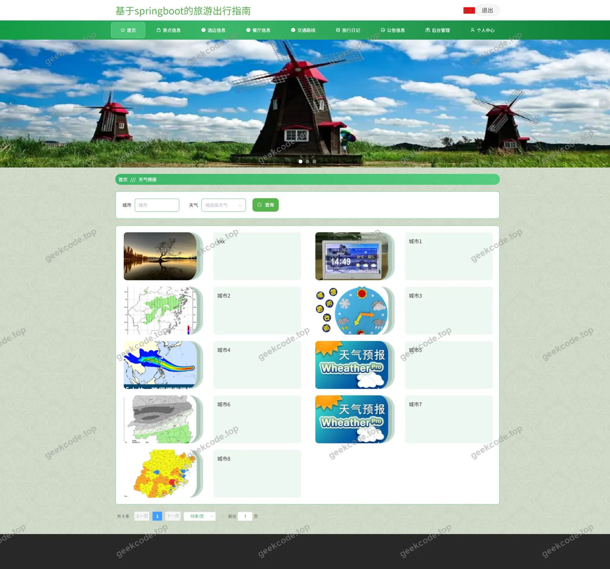</a>

<h4>前台-个人中心</h4>

<a href="https://geekcode.top/archives/%E5%9F%BA%E4%BA%8Espringboot%E7%9A%84%E6%97%85%E6%B8%B8%E5%87%BA%E8%A1%8C%E6%8C%87%E5%8D%97655ms-%E8%AE%BA%E6%96%87?utm_source=github" title="查看完整源码">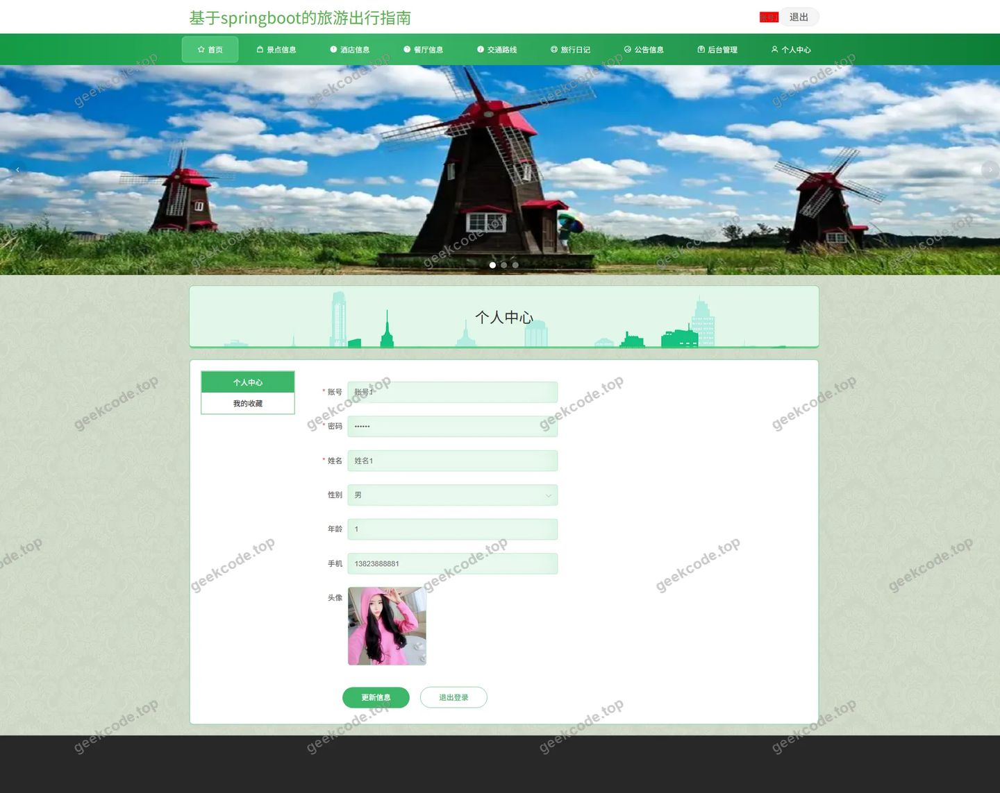</a>

<h4>前台-公告列表</h4>

<a href="https://geekcode.top/archives/%E5%9F%BA%E4%BA%8Espringboot%E7%9A%84%E6%97%85%E6%B8%B8%E5%87%BA%E8%A1%8C%E6%8C%87%E5%8D%97655ms-%E8%AE%BA%E6%96%87?utm_source=github" title="查看完整源码">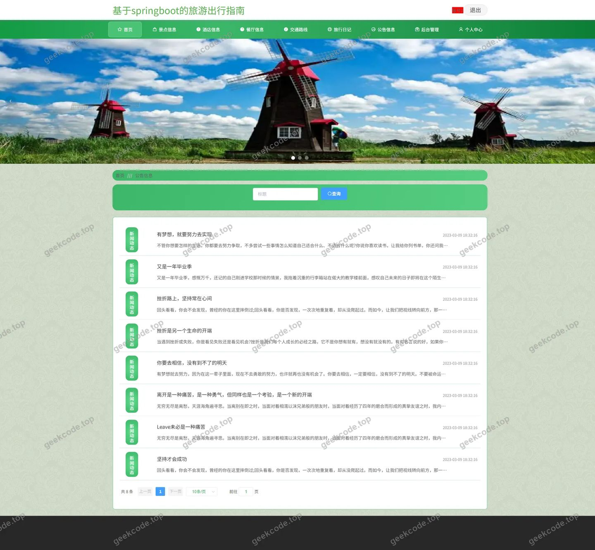</a>

<h3>后台管理端</h3>
<h4>后台-餐厅信息</h4>

<a href="https://geekcode.top/archives/%E5%9F%BA%E4%BA%8Espringboot%E7%9A%84%E6%97%85%E6%B8%B8%E5%87%BA%E8%A1%8C%E6%8C%87%E5%8D%97655ms-%E8%AE%BA%E6%96%87?utm_source=github" title="查看完整源码">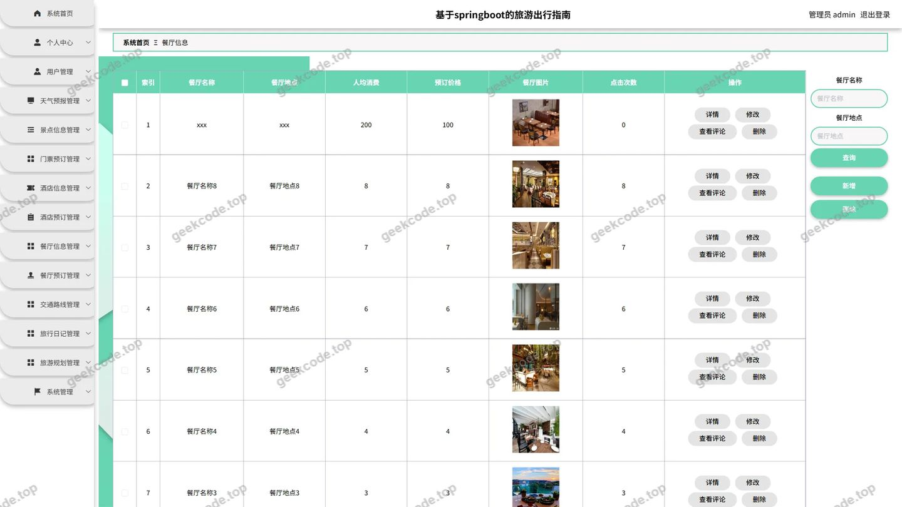</a>

<h4>后台-餐厅预订</h4>

<a href="https://geekcode.top/archives/%E5%9F%BA%E4%BA%8Espringboot%E7%9A%84%E6%97%85%E6%B8%B8%E5%87%BA%E8%A1%8C%E6%8C%87%E5%8D%97655ms-%E8%AE%BA%E6%96%87?utm_source=github" title="查看完整源码">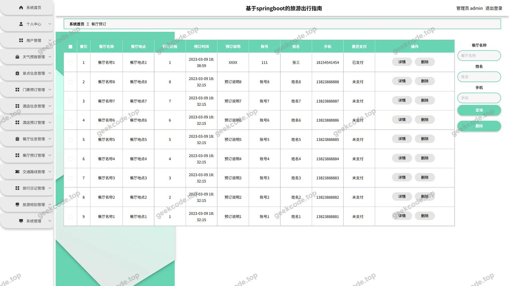</a>

<h4>后台-系统配置</h4>

<a href="https://geekcode.top/archives/%E5%9F%BA%E4%BA%8Espringboot%E7%9A%84%E6%97%85%E6%B8%B8%E5%87%BA%E8%A1%8C%E6%8C%87%E5%8D%97655ms-%E8%AE%BA%E6%96%87?utm_source=github" title="查看完整源码">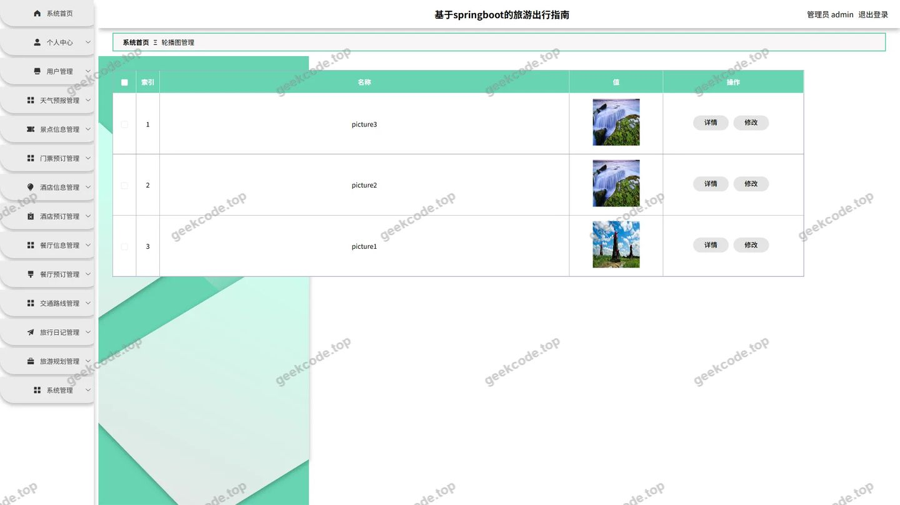</a>

<h4>后台-餐厅信息评论</h4>

<h4>后台-交通路线评论</h4>

<a href="https://geekcode.top/archives/%E5%9F%BA%E4%BA%8Espringboot%E7%9A%84%E6%97%85%E6%B8%B8%E5%87%BA%E8%A1%8C%E6%8C%87%E5%8D%97655ms-%E8%AE%BA%E6%96%87?utm_source=github" title="查看完整源码">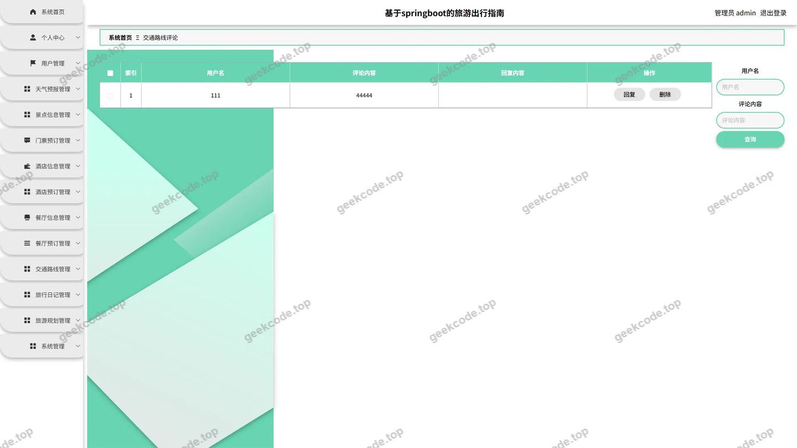</a>

<h4>后台-景点信息评论</h4>

<h4>后台-酒店信息评论</h4>

<h4>后台-旅行日记评论</h4>

<h4>后台首页</h4>

<a href="https://geekcode.top/archives/%E5%9F%BA%E4%BA%8Espringboot%E7%9A%84%E6%97%85%E6%B8%B8%E5%87%BA%E8%A1%8C%E6%8C%87%E5%8D%97655ms-%E8%AE%BA%E6%96%87?utm_source=github" title="查看完整源码">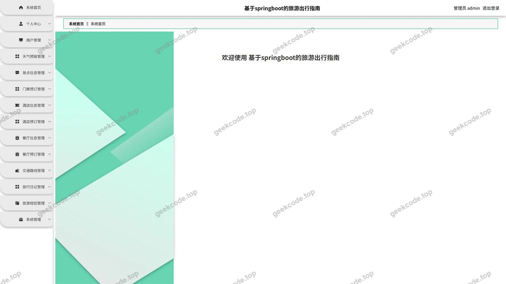</a>

<h4>后台-交通路线</h4>

<a href="https://geekcode.top/archives/%E5%9F%BA%E4%BA%8Espringboot%E7%9A%84%E6%97%85%E6%B8%B8%E5%87%BA%E8%A1%8C%E6%8C%87%E5%8D%97655ms-%E8%AE%BA%E6%96%87?utm_source=github" title="查看完整源码">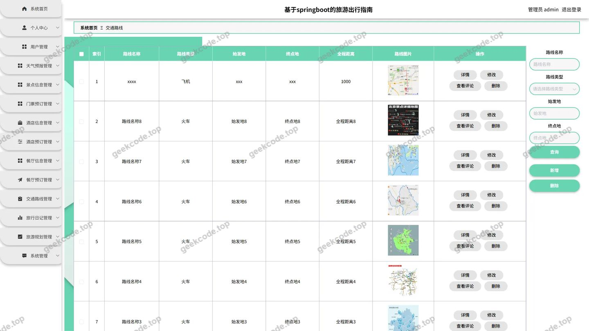</a>

<h4>后台-景点信息</h4>

<a href="https://geekcode.top/archives/%E5%9F%BA%E4%BA%8Espringboot%E7%9A%84%E6%97%85%E6%B8%B8%E5%87%BA%E8%A1%8C%E6%8C%87%E5%8D%97655ms-%E8%AE%BA%E6%96%87?utm_source=github" title="查看完整源码">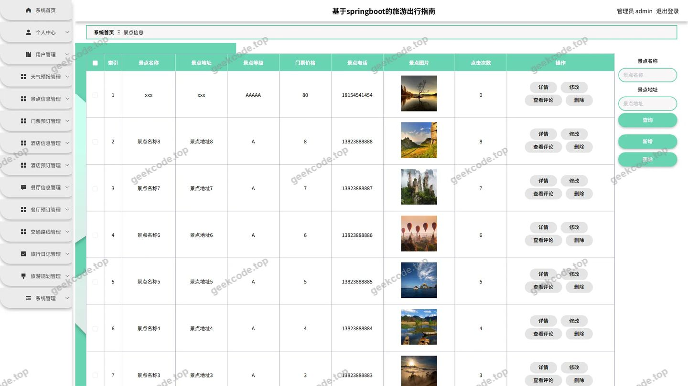</a>

<h4>后台-酒店信息</h4>

<a href="https://geekcode.top/archives/%E5%9F%BA%E4%BA%8Espringboot%E7%9A%84%E6%97%85%E6%B8%B8%E5%87%BA%E8%A1%8C%E6%8C%87%E5%8D%97655ms-%E8%AE%BA%E6%96%87?utm_source=github" title="查看完整源码">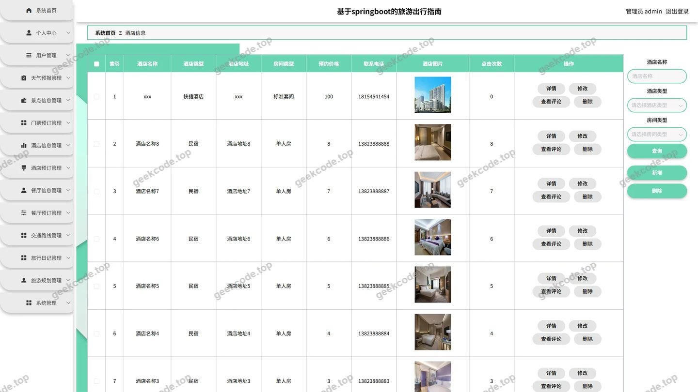</a>

<h4>后台-酒店预订</h4>

<a href="https://geekcode.top/archives/%E5%9F%BA%E4%BA%8Espringboot%E7%9A%84%E6%97%85%E6%B8%B8%E5%87%BA%E8%A1%8C%E6%8C%87%E5%8D%97655ms-%E8%AE%BA%E6%96%87?utm_source=github" title="查看完整源码">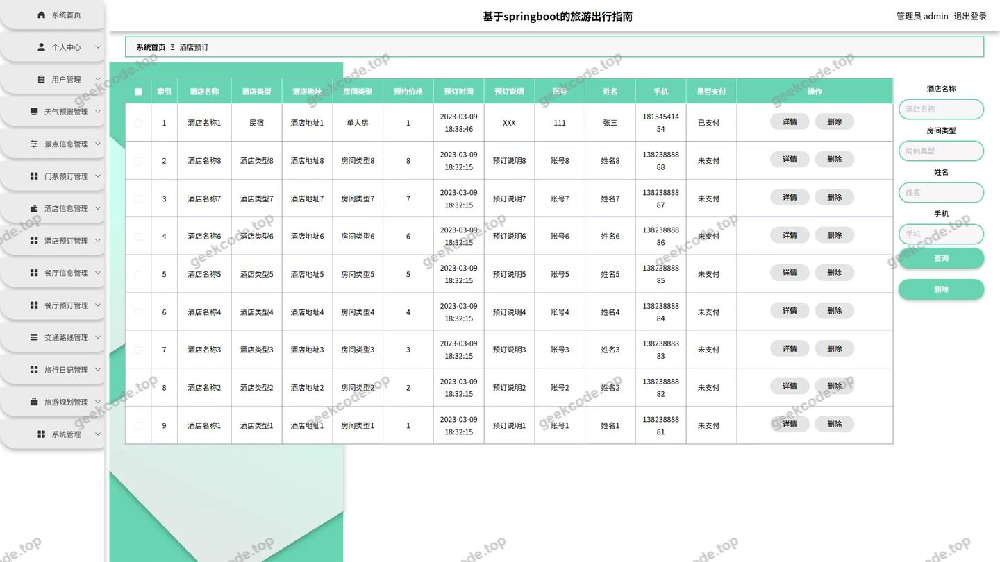</a>

<h4>后台-登录</h4>

<a href="https://geekcode.top/archives/%E5%9F%BA%E4%BA%8Espringboot%E7%9A%84%E6%97%85%E6%B8%B8%E5%87%BA%E8%A1%8C%E6%8C%87%E5%8D%97655ms-%E8%AE%BA%E6%96%87?utm_source=github" title="查看完整源码">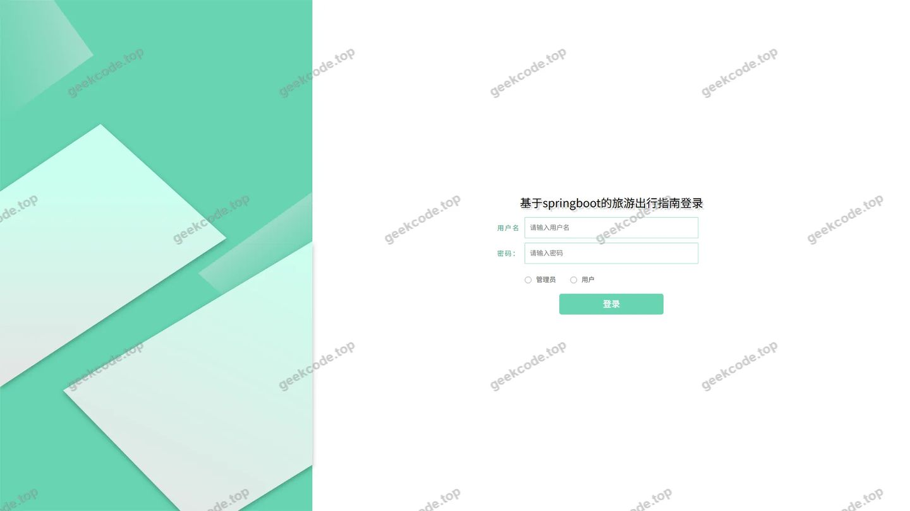</a>

<h4>后台-旅行日记</h4>

<a href="https://geekcode.top/archives/%E5%9F%BA%E4%BA%8Espringboot%E7%9A%84%E6%97%85%E6%B8%B8%E5%87%BA%E8%A1%8C%E6%8C%87%E5%8D%97655ms-%E8%AE%BA%E6%96%87?utm_source=github" title="查看完整源码">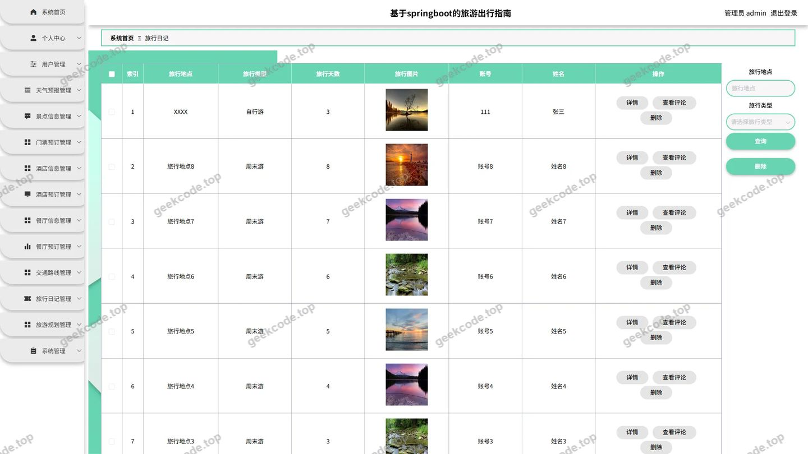</a>

<h4>后台-旅游规划</h4>

<a href="https://geekcode.top/archives/%E5%9F%BA%E4%BA%8Espringboot%E7%9A%84%E6%97%85%E6%B8%B8%E5%87%BA%E8%A1%8C%E6%8C%87%E5%8D%97655ms-%E8%AE%BA%E6%96%87?utm_source=github" title="查看完整源码">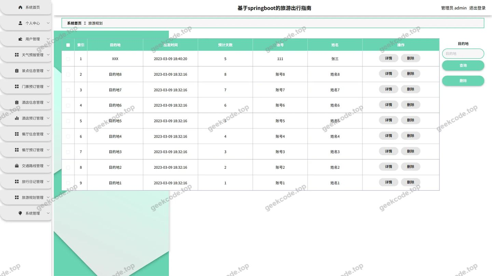</a>

<h4>后台-门票预订</h4>

<a href="https://geekcode.top/archives/%E5%9F%BA%E4%BA%8Espringboot%E7%9A%84%E6%97%85%E6%B8%B8%E5%87%BA%E8%A1%8C%E6%8C%87%E5%8D%97655ms-%E8%AE%BA%E6%96%87?utm_source=github" title="查看完整源码">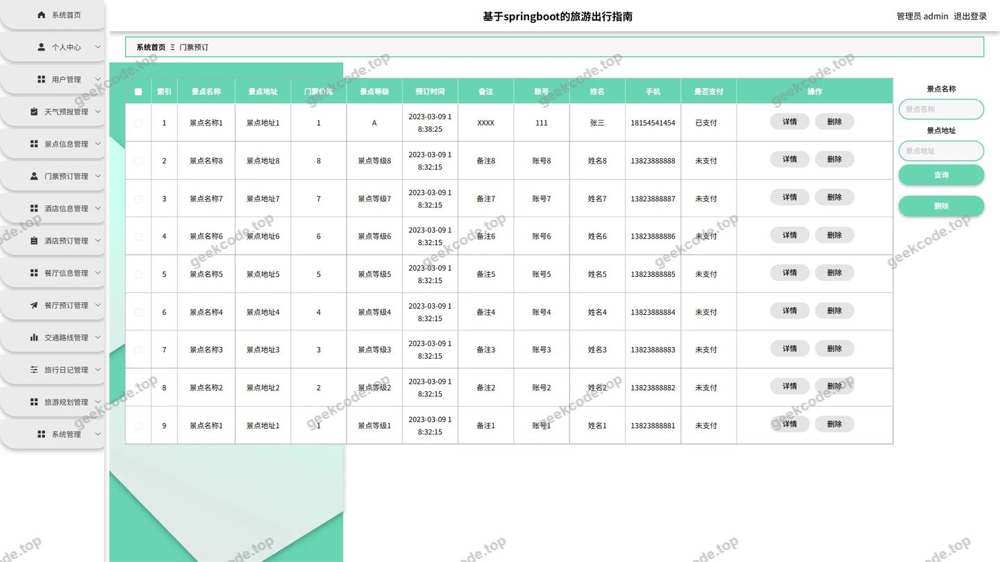</a>

<h4>后台-公告信息</h4>

<a href="https://geekcode.top/archives/%E5%9F%BA%E4%BA%8Espringboot%E7%9A%84%E6%97%85%E6%B8%B8%E5%87%BA%E8%A1%8C%E6%8C%87%E5%8D%97655ms-%E8%AE%BA%E6%96%87?utm_source=github" title="查看完整源码">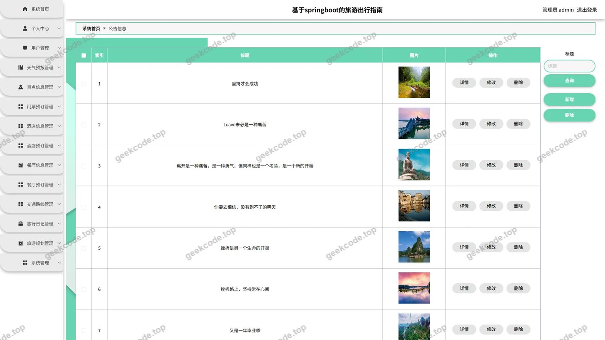</a>

<h4>后台-天气预报</h4>

<a href="https://geekcode.top/archives/%E5%9F%BA%E4%BA%8Espringboot%E7%9A%84%E6%97%85%E6%B8%B8%E5%87%BA%E8%A1%8C%E6%8C%87%E5%8D%97655ms-%E8%AE%BA%E6%96%87?utm_source=github" title="查看完整源码">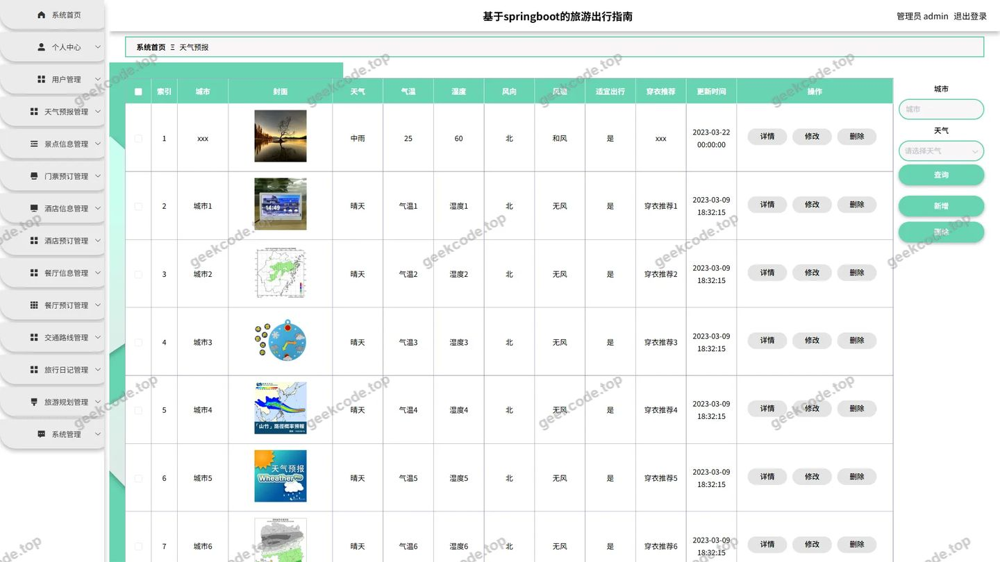</a>

---

## 获取完整源码

| 项目 | 说明 |
| --- | --- |
| 项目名 | 基于springboot的旅游出行指南655ms--论文 |
| 运行截图 | 本文 32 张（站点带水印原图，仓库 `images/` 目录） |
| 完整源码 | [https://geekcode.top/archives/%E5%9F%BA%E4%BA%8Espringboot%E7%9A%84%E6%97%85%E6%B8%B8%E5%87%BA%E8%A1%8C%E6%8C%87%E5%8D%97655ms-%E8%AE%BA%E6%96%87?utm_source=github](https://geekcode.top/archives/%E5%9F%BA%E4%BA%8Espringboot%E7%9A%84%E6%97%85%E6%B8%B8%E5%87%BA%E8%A1%8C%E6%8C%87%E5%8D%97655ms-%E8%AE%BA%E6%96%87?utm_source=github) |
| 咨询微信 | **ir9372**（备注：jingpin-yuanma） |
| 更多项目 | [极客代码 geekcode.top](https://geekcode.top/?utm_source=github) |

> 需要源码、部署、改配置、跑不起来等问题，加微信 ir9372 沟通，说明项目名即可。
